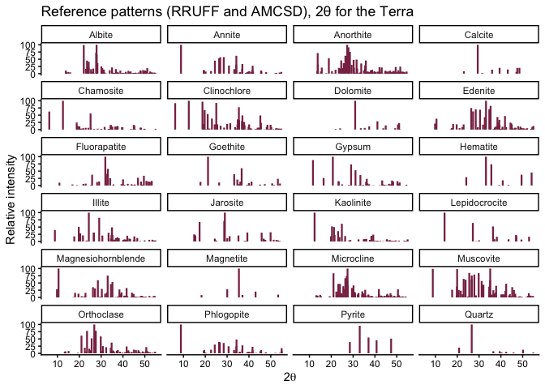

terraXRD: processing for XRD files coming from Terra Olympus XRD/XRF
portable instrument
================
Ruth E. Quispe-Pilco
2026-11-26

``` r
library(tidyverse)
```

    Warning: package 'ggplot2' was built under R version 4.5.2

    Warning: package 'tibble' was built under R version 4.5.2

    Warning: package 'tidyr' was built under R version 4.5.2

    Warning: package 'readr' was built under R version 4.5.2

    Warning: package 'purrr' was built under R version 4.5.2

    Warning: package 'dplyr' was built under R version 4.5.2

    Warning: package 'lubridate' was built under R version 4.5.2

    ── Attaching core tidyverse packages ──────────────────────── tidyverse 2.0.0 ──
    ✔ dplyr     1.2.1     ✔ readr     2.2.0
    ✔ forcats   1.0.1     ✔ stringr   1.6.0
    ✔ ggplot2   4.0.3     ✔ tibble    3.3.1
    ✔ lubridate 1.9.5     ✔ tidyr     1.3.2
    ✔ purrr     1.2.2     
    ── Conflicts ────────────────────────────────────────── tidyverse_conflicts() ──
    ✖ dplyr::filter() masks stats::filter()
    ✖ dplyr::lag()    masks stats::lag()
    ℹ Use the conflicted package (<http://conflicted.r-lib.org/>) to force all conflicts to become errors

# **1. Settings for terraXRD processing**

``` r
#Let's define first the folders, the instrument settings, and the list of samples used by all the scripts. 
#They are written here only once, so all scripts use the same values.
#Each script will load this script at the top with source ("steps/00_settings.R").

#Edit this for the first time when you start a new project with new samples.

setwd("~/Documents/Steve Lab/terraXRD_github") #This is the wd for the project. Inside there should be a samples and reference folder.
```

**Structure (folders)**

``` r
sample_dir <- "samples" ##This is the folder we are using for our samples (Olympus Terra output)
#There will be one folder per sample, as exported by the Terra.
metadata_path <- "metadata/sample_metadata.csv" ##Change this to the name of your metadata.
#The columns of this metadata should be like this: 
#samples | site | factor_1 | factor_2 | ...| factor_n
#The 1st column should always be the sample, followed by "site o location" and many others factors.
```

**Group comparisons (optional)**

``` r
#If you want to compare samples per group (For example, sediment/soil type, location, treatments, etc).
##"sample_type" is the column we are using for our example.
group_column <- "sample_type" #If you don't want to compare, write NULL.
#If you want to organize your plots and diffractograms in an specific order (distance from the glacier, microbial richness level, nitrogen content, etc)
#"distance_m" is the column we are using for our example. It is the distance from the glacier.
order_column <- NULL #It is a numeric column (like distance). #Write NULL if you just want to order by sample name.
```

**Reference minerals (editable)**

``` r
#Here you will find **DIF** files (Diffraction peaks of a pure mineral).
#They are in .txt format, and have a header and a list of peaks. 
#In the peak list, there are columns for:
##2-theta (angle of the peak),
##Intensity: This is a relative intensity, calculated from the crystal structure of the mineral.
##D-spacing: Distance between the planes of atoms, in Å.
##H K L : Miller indexes (They identify the family of paralel planes inside the mineral)
##There is an additional column for files coming from AMCSD.
##Multiplicity : Number of equivalent planes that diffract at the same angle.
#The workflow compares your sample peaks with these reference minerals.
#For your own project, you should revise, check and modify these reference minerals file
#Minerals from RRUFF database
rruff_dir <- "reference/rruff" #For more info about rruff: https://www.rruff.net/
amcsd_dir <- "reference/amcsd" #For more info about amcsd: https://www.rruff.net/amcsd/
```

**Output**

``` r
output_dir <- "output"
dir.create(output_dir, showWarnings = FALSE, recursive = TRUE)
```

**Instrument**

``` r
##Olympus Terra: Cu K-alpha1 radiation (value from terra file, .plv file)
lambda_terra <- 1.5406 ##Wavelength (Å)
range_2theta <- c(5,55) #Range (degrees 2θ) used by the instrument
```

**Sample files**

``` r
#Here you will find all your XRD files per sample. Terra instrument saved the files as samplename-ka.txt.
#The files should be inside samplename/processed.
sample_files <- list.files(sample_dir, pattern = "-ka\\.txt$",
                           recursive = TRUE, full.names = TRUE)
sample_files
```

     [1] "samples/FINE_ABS1_2_T1/processed/FINE_ABS1_2_T1-ka.txt"            
     [2] "samples/FINE_ABS1_25_3_T1/processed/FINE_ABS1_25_3_T1-ka.txt"      
     [3] "samples/FINE_ABS2_25_3_T1/processed/FINE_ABS2_25_3_T1-ka.txt"      
     [4] "samples/FINE_ABS2_25_4_T1/processed/FINE_ABS2_25_4_T1-ka.txt"      
     [5] "samples/FINE_ABS2_25_4_T2/processed/FINE_ABS2_25_4_T2-ka.txt"      
     [6] "samples/FINE_ABS2_25_5_T1/processed/FINE_ABS2_25_5_T1-ka.txt"      
     [7] "samples/FINE_ABS2_25_5_T2/processed/FINE_ABS2_25_5_T2-ka.txt"      
     [8] "samples/FINE_BLK1_1_T1/processed/FINE_BLK1_1_T1-ka.txt"            
     [9] "samples/FINE_BLK1_2_T1/processed/FINE_BLK1_2_T1-ka.txt"            
    [10] "samples/FINE_BLK1_3_T1/processed/FINE_BLK1_3_T1-ka.txt"            
    [11] "samples/FINE_BLK1_4_T1/processed/FINE_BLK1_4_T1-ka.txt"            
    [12] "samples/FINE_BLK1_5_T1/processed/FINE_BLK1_5_T1-ka.txt"            
    [13] "samples/FINE_BLK1_6_T1/processed/FINE_BLK1_6_T1-ka.txt"            
    [14] "samples/FINE_BLK2_6_T1/processed/FINE_BLK2_6_T1-ka.txt"            
    [15] "samples/FINE_clast_VBS1_25_1_T2/processed/FINE_VBS1_25_1_T2-ka.txt"
    [16] "samples/FINE_VBS1_25_1_T1/processed/FINE_VBS1_25_1_T1-ka.txt"      
    [17] "samples/FINE_VBS1_25_2_T1/processed/FINE_VBS1_25_2_t1-ka.txt"      
    [18] "samples/FINE_VBS1_25_3_T1/processed/FINE_VBS1_25_3_T1-ka.txt"      
    [19] "samples/FINE_VBS1_25_4_T1/processed/FINE_VBS1_25_4_T1-ka.txt"      
    [20] "samples/FINE_VBS2_25_1_T1/processed/FINE_VBS2_25_1_T1-ka.txt"      
    [21] "samples/FINE_VBS2_25_2_T1/processed/FINE_VBS2_25_2_T1-ka.txt"      
    [22] "samples/FINE_VBS2_25_2_T2/processed/FINE_VBS2_25_2_T2-ka.txt"      
    [23] "samples/FINE_VBS2_25_3_T1/processed/FINE_VBS2_25_3_T1-ka.txt"      
    [24] "samples/FINE_VBS2_25_4_T1/processed/FINE_VBS2_25_4_T1-ka.txt"      
    [25] "samples/FINE_VBS2_25_4_T2/processed/FINE_VBS2_25_4_T2-ka.txt"      

``` r
#Sample names (Taking the sample files)
names(sample_files) <- sub("-ka\\.txt$","",
                           basename(sample_files))
```

**Check**

``` r
#Message if something is missing
if (!dir.exists(sample_dir)){
  stop("Folder '", sample_dir, " ' not found. Check the setwd() line at the top of the script.")
}
if(length(sample_files) == 0) {
  warning("No '-ka.txt' files found in '",
          sample_dir, "'.",
          "Copy the Terra folders of your samples there.")
}
if (!file.exists(metadata_path)) {
  warning("Metadata file '", metadata_path, "' not found. ",
          "It is needed from Script 08 on (group comparison).")
}
message("terraXRD settings loaded: ", length(sample_files), " samples found in '",
        sample_dir, "'. Results will be saved in '", output_dir, "'.")
```

    terraXRD settings loaded: 25 samples found in 'samples'. Results will be saved in 'output'.

# **2. Reference patterns of the candidate minerals**

``` r
#Let's build the reference patterns of the minerals we expect in our samples.
#We are going to save all the peaks of the minerals from the two datasets into just one table as "01_reference_patterns.csv".
#If you add a new DIF file (for a new mineral), you should run this script again.

source("~/Documents/Steve Lab/terraXRD_github/steps/00_settings.R")
```

    terraXRD settings loaded: 25 samples found in 'samples'. Results will be saved in 'output'.

``` r
#Elements from the DIF file we are going to use:

##D-spacing: It does not depend on the X-ray wavelength, so we use it to calculate the 2θ
#of each peak for the Terra with Bragg's law: nλ = 2d sinθ (n = 1), therefore 2θ=2arcsin (λ/2d) 
#Bragg and Bragg, 1913.
#For example: quartz, d=3.3432 Å, 26.6 for the terra instrument.
##Intensity: relative intensity of each peak (Cullity and Stock, 2001, ch. 4).
#The 2θ column of the DIF files is calculated for another wavelength (1.541838 Å), so we don't use it.
```

**Step 1: List the DIF files**

``` r
## RRUFF names:  Quartz__R040031-1__Powder__DIF_File.txt
## AMCSD names:  Kaolinite__0020861.dif
rruff_files <- list.files(rruff_dir, pattern = "DIF_File", full.names = TRUE)
amcsd_files <- list.files(amcsd_dir, pattern = "\\.dif$", full.names = TRUE)
dif_files   <- c(rruff_files, amcsd_files)
dif_files
```

     [1] "reference/rruff/Albite__R050402-1__Powder__DIF_File__57a84423bc98156a93ad233c1e25.txt"       
     [2] "reference/rruff/Anorthite__R040059-1__Powder__DIF_File__47d57be300a4319e59b6337b8e9a.txt"    
     [3] "reference/rruff/Calcite__R050009-1__Powder__DIF_File__97b4c28fbb77e913386f3d5d260e.txt"      
     [4] "reference/rruff/Clinochlore__R060725-1__Powder__DIF_File__d628c54530e529668c4a193a12ea.txt"  
     [5] "reference/rruff/Dolomite__R040030-1__Powder__DIF_File__651daf175eae51957208cf19d61d.txt"     
     [6] "reference/rruff/Edenite__R050415-1__Powder__DIF_File__fb4e9a05d6c1c2f24d5bc53745e0.txt"      
     [7] "reference/rruff/Fluorapatite__R050194-1__Powder__DIF_File__7465414afc8c33ea618b8dd4fa17.txt" 
     [8] "reference/rruff/Goethite__R050142-1__Powder__DIF_File__42a347cec88ca0b914e898874c48.txt"     
     [9] "reference/rruff/Gypsum__R040029-1__Powder__DIF_File__bc7a410e34338723309d25286cc3.txt"       
    [10] "reference/rruff/Hematite__R060190-1__Powder__DIF_File__8fda56d8e06f88a76005c5bf19ee.txt"     
    [11] "reference/rruff/Jarosite__R060113-1__Powder__DIF_File__bf6c44f96db0cb42756eefc979b5.txt"     
    [12] "reference/rruff/Lepidocrocite__R050454-1__Powder__DIF_File__315b143333ae90fcbb7b6e1a0e47.txt"
    [13] "reference/rruff/Magnetite__R060656-1__Powder__DIF_File__67753c41e19cccb3466eb89a25d3.txt"    
    [14] "reference/rruff/Microcline__R050054-1__Powder__DIF_File__3be0537a34b4b68e3dcf70dac127.txt"   
    [15] "reference/rruff/Muscovite__R050080-1__Powder__DIF_File__d85c6ebdb823beb4068a1843bba7.txt"    
    [16] "reference/rruff/Orthoclase__R050185-1__Powder__DIF_File__14a099ebeafb2b62a6b7a502e4ab.txt"   
    [17] "reference/rruff/Phlogopite__R050068-1__Powder__DIF_File__872664933d6590b770da3e26e1cd.txt"   
    [18] "reference/rruff/Pyrite__R050070-1__Powder__DIF_File__c451532fd54599db61f18ee700aa.txt"       
    [19] "reference/rruff/Quartz__R040031-1__Powder__DIF_File__fbc232f5ecc5254e36fb5b97bd05.txt"       
    [20] "reference/amcsd/Annite__0004299.dif"                                                         
    [21] "reference/amcsd/Chamosite__0012235.dif"                                                      
    [22] "reference/amcsd/Illite__0005015.dif"                                                         
    [23] "reference/amcsd/Kaolinite__0020861.dif"                                                      
    [24] "reference/amcsd/Magnesiohornblende__0006602.dif"                                             

``` r
length(dif_files)   ## number of minerals
```

    [1] 24

**Step 2: Function to read a DIF file**

``` r
#Let's run a function to read one DIF file from dif_files.
read_dif <- function(dif_file) {
  #1. Read the lines of the DIF file and keep the peak list
  ##(lines after "2-THETA" that start with numbers)
  dif_lines <- readLines(dif_file)
  peak_lines <- str_subset(dif_lines[-(1:grep("2-THETA", dif_lines))], "^\\s*[0-9.]+\\s+[0-9.]+")
  #2. Intensity (column 2) and d-spacing (column 3); sum peaks with the same d-spacing
  ##(e.g. quartz planes 011 and 101: in the pattern they are one peak)
  as_tibble(read.table(text = peak_lines)) %>%
    dplyr::summarise(intensity = sum(V2), .by = V3) %>% #dplyr:: avoids a clash with plyr
    dplyr::rename(d_spacing = V3) %>%
    arrange(desc(d_spacing)) %>%
    #3. Relative intensity (strongest peak = 100) and 2θ for the Terra (Bragg's law),
    ##within the Terra range (range_2theta in 00_settings)
    mutate(rel_intensity = 100 * intensity / max(intensity),
           two_theta = 2 * asin(lambda_terra / (2 * d_spacing)) * 180 / pi) %>%
    filter(between(two_theta, range_2theta[1], range_2theta[2])) %>%
    #4. Mineral name, database and code (from the file name)
    mutate(mineral = str_extract(basename(dif_file), "^[^_]+"), #Text before the first "_"
           source = if_else(str_detect(dif_file, "amcsd"), "AMCSD", "RRUFF"),
           ref_id = str_extract(basename(dif_file), "R[0-9]+|[0-9]+(?=\\.dif$)")) #RRUFF: R + digits; AMCSD: digits before .dif
}
```

**Step 3: All DIF files into one table**

``` r
reference_patterns <- map_dfr(dif_files, read_dif)
head(reference_patterns)
```

    # A tibble: 6 × 7
      d_spacing intensity rel_intensity two_theta mineral source ref_id 
          <dbl>     <dbl>         <dbl>     <dbl> <chr>   <chr>  <chr>  
    1      6.39     10.8          10.8       13.8 Albite  RRUFF  R050402
    2      6.38      4.21          4.21      13.9 Albite  RRUFF  R050402
    3      6.34      3.6           3.6       13.9 Albite  RRUFF  R050402
    4      6.30      3.99          3.99      14.0 Albite  RRUFF  R050402
    5      5.91      5.21          5.21      15.0 Albite  RRUFF  R050402
    6      5.59      4.43          4.43      15.9 Albite  RRUFF  R050402

``` r
dim(reference_patterns)
```

    [1] 1041    7

``` r
#Let's check the number of peak per mineral
reference_patterns %>% dplyr::count(source, mineral, ref_id) %>%
  print(n =Inf)
```

    # A tibble: 24 × 4
       source mineral            ref_id      n
       <chr>  <chr>              <chr>   <int>
     1 AMCSD  Annite             0004299    45
     2 AMCSD  Chamosite          0012235    58
     3 AMCSD  Illite             0005015    47
     4 AMCSD  Kaolinite          0020861    47
     5 AMCSD  Magnesiohornblende 0006602    59
     6 RRUFF  Albite             R050402    92
     7 RRUFF  Anorthite          R040059   110
     8 RRUFF  Calcite            R050009     9
     9 RRUFF  Clinochlore        R060725    64
    10 RRUFF  Dolomite           R040030    13
    11 RRUFF  Edenite            R050415    67
    12 RRUFF  Fluorapatite       R050194    30
    13 RRUFF  Goethite           R050142    18
    14 RRUFF  Gypsum             R040029    36
    15 RRUFF  Hematite           R060190     8
    16 RRUFF  Jarosite           R060113    24
    17 RRUFF  Lepidocrocite      R050454    12
    18 RRUFF  Magnetite          R060656     6
    19 RRUFF  Microcline         R050054   106
    20 RRUFF  Muscovite          R050080    71
    21 RRUFF  Orthoclase         R050185    63
    22 RRUFF  Phlogopite         R050068    42
    23 RRUFF  Pyrite             R050070     5
    24 RRUFF  Quartz             R040031     9

**Reference pattern plots**

``` r
#We are going to build one panel per mineral, one vertical line per peak.
#This is good so we can see what we expect to identify in our samples. Also to see if this takes the corre angle range.

reference_plot <- ggplot(reference_patterns) +
  geom_segment(aes(x = two_theta, xend = two_theta, y = 0, yend = rel_intensity),
               color = "#892f52", linewidth = 0.8) +
  facet_wrap(~ mineral, ncol = 4) +
  coord_cartesian(xlim = range_2theta) +
  labs(title = "Reference patterns (RRUFF and AMCSD), 2θ for the Terra",
       x = expression(2*theta), y = "Relative intensity") +
  theme_classic()
reference_plot
```

<!-- -->

``` r
#You can save this plot if you want 
ggsave(file.path(output_dir, "01_reference_patterns.png"), reference_plot,
       width = 10, height = 2 + 2 * ceiling(length(dif_files) / 4), dpi = 300)
#And you can save this information as a table
write_csv(reference_patterns, file.path(output_dir, "01_reference_patterns.csv"))

#References ----
#Bragg, W. H., and Bragg, W. L. (1913). The reflection of X-rays by crystals.
#Proc. R. Soc. Lond. A 88, 428-438. doi:10.1098/rspa.1913.0040
#Cullity, B. D., and Stock, S. R. (2001). Elements of X-Ray Diffraction, 3rd Edn.
#Upper Saddle River, NJ: Prentice Hall.
```
