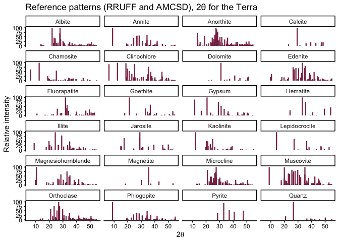
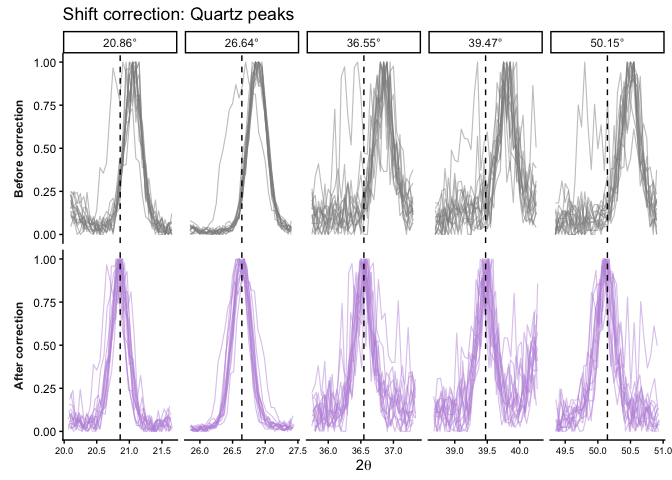

terraXRD: processing for XRD files coming from Terra Olympus XRD/XRF
portable instrument
================
Ruth E. Quispe-Pilco
2026-11-26

This is a workflow for processing XRD patterns of natural samples
anzlyzed by the Terra Olympus XRD/XRF portable instrument. We use our
samples results, a reference database and a metadata. The results of
this workflow gives a qualitative identification of the mineral phases
in each sample.

``` r
library(tidyverse)
```

# **1. Settings for terraXRD processing**

``` r
#Let's define first the folders, the instrument settings, and the list of samples used by all the scripts. 
#They are written here only once, so all scripts use the same values.
#Each script will load this script at the top with source ("steps/00_settings.R").

#Edit this for the first time when you start a new project with new samples.

setwd("~/Documents/Steve Lab/terraXRD_github") #This is the wd for the project. Inside there should be a samples and reference folder.
```

**Structure (folders)**

``` r
sample_dir <- "samples" ##This is the folder we are using for our samples (Olympus Terra output)
#There will be one folder per sample, as exported by the Terra.
metadata_path <- "metadata/sample_metadata.csv" ##Change this to the name of your metadata.
#The columns of this metadata should be like this: 
#samples | site | factor_1 | factor_2 | ...| factor_n
#The 1st column should always be the sample, followed by "site o location" and many others factors.
```

**Group comparisons (optional)**

``` r
#If you want to compare samples per group (For example, sediment/soil type, location, treatments, etc).
##"sample_type" is the column we are using for our example.
group_column <- "sample_type" #If you don't want to compare, write NULL.
#If you want to organize your plots and diffractograms in an specific order (distance from the glacier, microbial richness level, nitrogen content, etc)
#"distance_m" is the column we are using for our example. It is the distance from the glacier.
order_column <- NULL #It is a numeric column (like distance). #Write NULL if you just want to order by sample name.
```

**Reference minerals (editable)**

``` r
#Here you will find **DIF** files (Diffraction peaks of a pure mineral).
#They are in .txt format, and have a header and a list of peaks. 
#In the peak list, there are columns for:
##2-theta (angle of the peak),
##Intensity: This is a relative intensity, calculated from the crystal structure of the mineral.
##D-spacing: Distance between the planes of atoms, in Å.
##H K L : Miller indexes (They identify the family of paralel planes inside the mineral)
##There is an additional column for files coming from AMCSD.
##Multiplicity : Number of equivalent planes that diffract at the same angle.
#The workflow compares your sample peaks with these reference minerals.
#For your own project, you should revise, check and modify these reference minerals file
#Minerals from RRUFF database
rruff_dir <- "reference/rruff" #For more info about rruff: https://www.rruff.net/
amcsd_dir <- "reference/amcsd" #For more info about amcsd: https://www.rruff.net/amcsd/
```

**Internal standard for the 2θ shift correction**

``` r
#This is the mineral we are going to use to correct the 2θ shift of each sample.
#It must be present in all the samples, have strong sharp peaks and a stable composition, and have its DIF file in the reference folders. 
#This example and for this study, we used quartz.
#If your samples have little or no quartz, you can use another mineral naturally present in all of them.
standard_mineral <- "Quartz" #Name as in the DIF file (e.g. "Quartz", "Gypsum", etc.)
```

**Output**

``` r
output_dir <- "output"
dir.create(output_dir, showWarnings = FALSE, recursive = TRUE)
```

**Instrument**

``` r
##Olympus Terra: Cu K-alpha1 radiation (value from terra file, .plv file)
lambda_terra <- 1.5406 ##Wavelength (Å)
range_2theta <- c(5,55) #Range (degrees 2θ) used by the instrument
```

**Sample files**

``` r
#Here you will find all your XRD files per sample. Terra instrument saved the files as samplename-ka.txt.
#The files should be inside samplename/processed.
sample_files <- list.files(sample_dir, pattern = "-ka\\.txt$",
                           recursive = TRUE, full.names = TRUE)
sample_files
```

>  \[1\] “samples/SUN001_1_2_3/processed/SUN001_1_2_3-ka.txt”<br>
>  \[2\] “samples/SUN002_1_2_3/processed/SUN002_1_2_3-ka.txt”<br>
>  \[3\] “samples/SUN004_1_2_3/processed/SUN004_1_2_3-ka.txt”<br>
>  \[4\] “samples/SUN005_1_2_3/processed/SUN005_1_2_3-ka.txt”<br>
>  \[5\] “samples/SUN008_1_2_3/processed/SUN008_1_2_3-ka.txt”<br>
>  \[6\] “samples/SUN009_1_2_3/processed/SUN009_1_2_3-ka.txt”<br>
>  \[7\] “samples/SUN010_1_2_3/processed/SUN010_1_2_3-ka.txt”<br>
>  \[8\] “samples/SUN011_1_2_3/processed/SUN011_1_2_3-ka.txt”<br>
>  \[9\] “samples/SUN012_1_2_3/processed/SUN012_1_2_3-ka.txt”<br>
> \[10\] “samples/SUN013_1_2_3/processed/SUN013_1_2_3-ka.txt”<br>
> \[11\] “samples/SUN014_1_2_3/processed/SUN014_1_2_3-ka.txt”<br>
> \[12\] “samples/SUN015_1_2_3/processed/SUN015_1_2_3-ka.txt”<br>
> \[13\] “samples/SUN016_1_2_3/processed/SUN016_1_2_3-ka.txt”<br>
> \[14\] “samples/SUN017_1_2_3/processed/SUN017_1_2_3-ka.txt”<br>
> \[15\] “samples/SUN018_1_2_3/processed/SUN018_1_2_3-ka.txt”<br>

``` r
#Sample names (Taking the sample files)
names(sample_files) <- sub("-ka\\.txt$","",
                           basename(sample_files))
```

**Check**

``` r
#Message if something is missing
if (!dir.exists(sample_dir)){
  stop("Folder '", sample_dir, " ' not found. Check the setwd() line at the top of the script.")
}
if(length(sample_files) == 0) {
  warning("No '-ka.txt' files found in '",
          sample_dir, "'.",
          "Copy the Terra folders of your samples there.")
}
if (!file.exists(metadata_path)) {
  warning("Metadata file '", metadata_path, "' not found. ",
          "It is needed from Script 08 on (group comparison).")
}
message("terraXRD settings loaded: ", length(sample_files), " samples found in '",
        sample_dir, "'. Results will be saved in '", output_dir, "'.")
```

# **2. Reference patterns of the candidate minerals**

Here we recalculate the 2θ for each candidate mineral. The 2θ of a peak
depends on the X-ray wavelength (Bragg’s law). RRUFF and AMCSD calculate
the 2θ of their DIF files for a wavelength of 1.541838 Å (weighted mean
of Cu Kα1 and Kα2), while the Terra measures with Cu Kα1 (1.5406 Å). To
place the reference peaks where the Terra would see them, we use the
d-spacing, which does not depend on the wavelength, and calculate the 2θ
with the wavelength of the Terra: 2θ = 2 arcsin(λ / 2d) (Bragg and
Bragg, 1913). For example, the main quartz peak (d = 3.3432 Å) is at
26.66° in the DIF file and at 26.64° for the Terra.

``` r
#Let's build the reference patterns of the minerals we expect in our samples.
#We are going to save all the peaks of the minerals from the two datasets into just one table as "01_reference_patterns.csv".
#If you add a new DIF file (for a new mineral), you should run this script again.

source("~/Documents/Steve Lab/terraXRD_github/steps/00_settings.R")

#Elements from the DIF file we are going to use:

##D-spacing: It does not depend on the X-ray wavelength, so we use it to calculate the 2θ
#of each peak for the Terra with Bragg's law: nλ = 2d sinθ (n = 1), therefore 2θ=2arcsin (λ/2d) 
#Bragg and Bragg, 1913.
#For example: quartz, d=3.3432 Å, 26.6 for the terra instrument.
##Intensity: relative intensity of each peak (Cullity and Stock, 2001, ch. 4).
#The 2θ column of the DIF files is calculated for another wavelength (1.541838 Å), so we don't use it.We will calculate a new one.
```

**Step 1: List the DIF files**

``` r
## RRUFF names:  Quartz__R040031-1__Powder__DIF_File.txt
## AMCSD names:  Kaolinite__0020861.dif
rruff_files <- list.files(rruff_dir, pattern = "DIF_File", full.names = TRUE)
amcsd_files <- list.files(amcsd_dir, pattern = "\\.dif$", full.names = TRUE)
dif_files   <- c(rruff_files, amcsd_files)
dif_files
```

>  \[1\] “reference/rruff/Albite\_\_R050402-1\_\_Powder\_\_DIF_File\_\_57a84423bc98156a93ad233c1e25.txt”       <br>
>  \[2\] “reference/rruff/Anorthite\_\_R040059-1\_\_Powder\_\_DIF_File\_\_47d57be300a4319e59b6337b8e9a.txt”    <br>
>  \[3\] “reference/rruff/Calcite\_\_R050009-1\_\_Powder\_\_DIF_File\_\_97b4c28fbb77e913386f3d5d260e.txt”      <br>
>  \[4\] “reference/rruff/Clinochlore\_\_R060725-1\_\_Powder\_\_DIF_File\_\_d628c54530e529668c4a193a12ea.txt”  <br>
>  \[5\] “reference/rruff/Dolomite\_\_R040030-1\_\_Powder\_\_DIF_File\_\_651daf175eae51957208cf19d61d.txt”     <br>
>  \[6\] “reference/rruff/Edenite\_\_R050415-1\_\_Powder\_\_DIF_File\_\_fb4e9a05d6c1c2f24d5bc53745e0.txt”      <br>
>  \[7\] “reference/rruff/Fluorapatite\_\_R050194-1\_\_Powder\_\_DIF_File\_\_7465414afc8c33ea618b8dd4fa17.txt” <br>
>  \[8\] “reference/rruff/Goethite\_\_R050142-1\_\_Powder\_\_DIF_File\_\_42a347cec88ca0b914e898874c48.txt”     <br>
>  \[9\] “reference/rruff/Gypsum\_\_R040029-1\_\_Powder\_\_DIF_File\_\_bc7a410e34338723309d25286cc3.txt”       <br>
> \[10\] “reference/rruff/Hematite\_\_R060190-1\_\_Powder\_\_DIF_File\_\_8fda56d8e06f88a76005c5bf19ee.txt”     <br>
> \[11\] “reference/rruff/Jarosite\_\_R060113-1\_\_Powder\_\_DIF_File\_\_bf6c44f96db0cb42756eefc979b5.txt”     <br>
> \[12\] “reference/rruff/Lepidocrocite\_\_R050454-1\_\_Powder\_\_DIF_File\_\_315b143333ae90fcbb7b6e1a0e47.txt”<br>
> \[13\] “reference/rruff/Magnetite\_\_R060656-1\_\_Powder\_\_DIF_File\_\_67753c41e19cccb3466eb89a25d3.txt”    <br>
> \[14\] “reference/rruff/Microcline\_\_R050054-1\_\_Powder\_\_DIF_File\_\_3be0537a34b4b68e3dcf70dac127.txt”   <br>
> \[15\] “reference/rruff/Muscovite\_\_R050080-1\_\_Powder\_\_DIF_File\_\_d85c6ebdb823beb4068a1843bba7.txt”    <br>
> \[16\] “reference/rruff/Orthoclase\_\_R050185-1\_\_Powder\_\_DIF_File\_\_14a099ebeafb2b62a6b7a502e4ab.txt”   <br>
> \[17\] “reference/rruff/Phlogopite\_\_R050068-1\_\_Powder\_\_DIF_File\_\_872664933d6590b770da3e26e1cd.txt”   <br>
> \[18\] “reference/rruff/Pyrite\_\_R050070-1\_\_Powder\_\_DIF_File\_\_c451532fd54599db61f18ee700aa.txt”       <br>
> \[19\] “reference/rruff/Quartz\_\_R040031-1\_\_Powder\_\_DIF_File\_\_fbc232f5ecc5254e36fb5b97bd05.txt”       <br>
> \[20\] “reference/amcsd/Annite\_\_0004299.dif”                                                         <br>
> \[21\] “reference/amcsd/Chamosite\_\_0012235.dif”                                                      <br>
> \[22\] “reference/amcsd/Illite\_\_0005015.dif”                                                         <br>
> \[23\] “reference/amcsd/Kaolinite\_\_0020861.dif”                                                      <br>
> \[24\] “reference/amcsd/Magnesiohornblende\_\_0006602.dif”                                             <br>

``` r
length(dif_files)   ## number of minerals
```

> \[1\] 24<br>

**Step 2: Function to read a DIF file and to get its 2θ**

``` r
#Let's run a function to read a DIF file and to calculate the 2θ value for each peak.
#It will take the dif files from dif_files.
read_dif <- function(dif_file) {
  #1. Read the lines of the DIF file and keep the peak list
  ##(lines after "2-THETA" that start with numbers)
  dif_lines <- readLines(dif_file)
  peak_lines <- str_subset(dif_lines[-(1:grep("2-THETA", dif_lines))], "^\\s*[0-9.]+\\s+[0-9.]+")
  #2. Intensity (column 2) and d-spacing (column 3); sum peaks with the same d-spacing
  ##(e.g. quartz planes 011 and 101: in the pattern they are one peak)
  as_tibble(read.table(text = peak_lines)) %>%
    dplyr::summarise(intensity = sum(V2), .by = V3) %>% #dplyr:: avoids a clash with plyr
    dplyr::rename(d_spacing = V3) %>%
    arrange(desc(d_spacing)) %>%
    #3. Relative intensity (strongest peak = 100) and 2θ for the Terra (Bragg's law),
    ##within the Terra range (range_2theta in 00_settings)
    mutate(rel_intensity = 100 * intensity / max(intensity),
           two_theta = 2 * asin(lambda_terra / (2 * d_spacing)) * 180 / pi) %>%
    filter(between(two_theta, range_2theta[1], range_2theta[2])) %>%
    #4. Mineral name, database and code (from the file name)
    mutate(mineral = str_extract(basename(dif_file), "^[^_]+"), #Text before the first "_"
           source = if_else(str_detect(dif_file, "amcsd"), "AMCSD", "RRUFF"),
           ref_id = str_extract(basename(dif_file), "R[0-9]+|[0-9]+(?=\\.dif$)")) #RRUFF: R + digits; AMCSD: digits before .dif
}
```

**Step 3: All DIF files into one table**

``` r
reference_patterns <- map_dfr(dif_files, read_dif)
head(reference_patterns)
```

<div class="kable-table">

| d_spacing | intensity | rel_intensity | two_theta | mineral | source | ref_id  |
|----------:|----------:|--------------:|----------:|:--------|:-------|:--------|
|    6.3899 |     10.75 |         10.75 |  13.84765 | Albite  | RRUFF  | R050402 |
|    6.3766 |      4.21 |          4.21 |  13.87667 | Albite  | RRUFF  | R050402 |
|    6.3444 |      3.60 |          3.60 |  13.94745 | Albite  | RRUFF  | R050402 |
|    6.3004 |      3.99 |          3.99 |  14.04534 | Albite  | RRUFF  | R050402 |
|    5.9124 |      5.21 |          5.21 |  14.97218 | Albite  | RRUFF  | R050402 |
|    5.5862 |      4.43 |          4.43 |  15.85193 | Albite  | RRUFF  | R050402 |

</div>

``` r
dim(reference_patterns)
```

> \[1\] 1041    7<br>

``` r
#Let's check the number of peak per mineral
reference_patterns %>% dplyr::count(source, mineral, ref_id) %>%
  print(n =Inf)
```

> \# A tibble: 24 × 4<br>    source mineral            ref_id      n<br>
>    <chr>  <chr>              <chr>   <int><br>
>  1 AMCSD  Annite             0004299    45<br>
>  2 AMCSD  Chamosite          0012235    58<br>
>  3 AMCSD  Illite             0005015    47<br>
>  4 AMCSD  Kaolinite          0020861    47<br>
>  5 AMCSD  Magnesiohornblende 0006602    59<br>
>  6 RRUFF  Albite             R050402    92<br>
>  7 RRUFF  Anorthite          R040059   110<br>
>  8 RRUFF  Calcite            R050009     9<br>
>  9 RRUFF  Clinochlore        R060725    64<br>
> 10 RRUFF  Dolomite           R040030    13<br>
> 11 RRUFF  Edenite            R050415    67<br>
> 12 RRUFF  Fluorapatite       R050194    30<br>
> 13 RRUFF  Goethite           R050142    18<br>
> 14 RRUFF  Gypsum             R040029    36<br>
> 15 RRUFF  Hematite           R060190     8<br>
> 16 RRUFF  Jarosite           R060113    24<br>
> 17 RRUFF  Lepidocrocite      R050454    12<br>
> 18 RRUFF  Magnetite          R060656     6<br>
> 19 RRUFF  Microcline         R050054   106<br>
> 20 RRUFF  Muscovite          R050080    71<br>
> 21 RRUFF  Orthoclase         R050185    63<br>
> 22 RRUFF  Phlogopite         R050068    42<br>
> 23 RRUFF  Pyrite             R050070     5<br>
> 24 RRUFF  Quartz             R040031     9<br>

**Reference pattern plots**

``` r
#We are going to build one panel per mineral, one vertical line per peak.
#This is good so we can see what we expect to identify in our samples. Also to see if this takes the corre angle range.

reference_plot <- ggplot(reference_patterns) +
  geom_segment(aes(x = two_theta, xend = two_theta, y = 0, yend = rel_intensity),
               color = "#892f52", linewidth = 0.8) +
  facet_wrap(~ mineral, ncol = 4) +
  coord_cartesian(xlim = range_2theta) +
  labs(title = "Reference patterns (RRUFF and AMCSD), 2θ for the Terra",
       x = expression(2*theta), y = "Relative intensity") +
  theme_classic()
reference_plot
```

<!-- -->

``` r
#You can save this plot if you want 
ggsave(file.path(output_dir, "01_reference_patterns.png"), reference_plot,
       width = 10, height = 2 + 2 * ceiling(length(dif_files) / 4), dpi = 300)
#And you can save this information as a table (This will be necessary later on)
write_csv(reference_patterns, file.path(output_dir, "01_reference_patterns.csv"))

#References ----
#Bragg, W. H., and Bragg, W. L. (1913). The reflection of X-rays by crystals.
#Proc. R. Soc. Lond. A 88, 428-438. doi:10.1098/rspa.1913.0040
#Cullity, B. D., and Stock, S. R. (2001). Elements of X-Ray Diffraction, 3rd Edn.
#Upper Saddle River, NJ: Prentice Hall.
```

# **3. Shift correction of Sample XRD patterns**

Above, we calculated where the reference peaks should be for Terra. Now,
we are going to correct the measured patterns of the samples, whose
peaks could be displaced by the position of the sample in the holder or
by the instrument. If we do not do this correction, the sample’s peaks
will not match the reference peaks. Here, we are going to use our
internal standard, which for this study is quartz (As designated above).

**Read the patterns of all the samples**

``` r
#Here we load the -ka.txt files from each sample and join them in one table, skipping the header of each file.
#The table has a column for each sample name, for the 2θ and for the intenstiy (counts).

read_pattern <- function(ka_file) {
  read.table(ka_file, comment.char = "#", col.names = c("two_theta", "counts"))
}
#Join all of them in a table called "patterns":
patterns <- map_dfr(sample_files, read_pattern, .id = "sample")
head(patterns)
```

<div class="kable-table">

| sample       | two_theta |  counts |
|:-------------|----------:|--------:|
| SUN001_1_2_3 |      5.00 | 36.2028 |
| SUN001_1_2_3 |      5.05 | 16.2144 |
| SUN001_1_2_3 |      5.10 | 30.4667 |
| SUN001_1_2_3 |      5.15 | 46.6938 |
| SUN001_1_2_3 |      5.20 | 21.8887 |
| SUN001_1_2_3 |      5.25 | 30.1123 |

</div>

``` r
#Let's check the number of counts per sample.All the samples should be listed and have the same number of 
#points (1001 in our Terra files: 5 to 55° every 0.05°). This number depends on the range and 
#step of the measurement (in the .plv file of each sample). If you used another range or
#your number will be different. A sample with fewer points than the others may be an incomplete file.
patterns %>% dplyr::count(sample)
```

<div class="kable-table">

| sample       |    n |
|:-------------|-----:|
| SUN001_1_2_3 | 1001 |
| SUN002_1_2_3 | 1001 |
| SUN004_1_2_3 | 1001 |
| SUN005_1_2_3 | 1001 |
| SUN008_1_2_3 | 1001 |
| SUN009_1_2_3 | 1001 |
| SUN010_1_2_3 | 1001 |
| SUN011_1_2_3 | 1001 |
| SUN012_1_2_3 | 1001 |
| SUN013_1_2_3 | 1001 |
| SUN014_1_2_3 | 1001 |
| SUN015_1_2_3 | 1001 |
| SUN016_1_2_3 | 1001 |
| SUN017_1_2_3 | 1001 |
| SUN018_1_2_3 | 1001 |

</div>

**Peaks of the internal standard**

``` r
#Quartz has 9 peaks between 5 to 55°, and 5 of them have the higher relative intensity (>=7).
#If you are using another internal standard, check the higher relative intensities and choose them.
#There is no fixed rule for this threshold, it is a practical choice. For quartz, there is a clear gap between
#its strong peaks (relative intensity >= 7.1) and its weak ones (<= 5.2), so we use 7.
#This keeps 5 peaks spread over the range (20.86, 26.64, 36.55, 39.47 and 50.15°).
#If you use another standard mineral, look at its reference peaks (Script 01) and
#choose a threshold that keeps its strong peaks.
reference_patterns <- read_csv(file.path(output_dir, "01_reference_patterns.csv"),
                               show_col_types = FALSE)
#Let's see only the values for the standard mineral:
reference_patterns %>%
  filter(mineral == standard_mineral) %>%
  arrange(desc(rel_intensity)) %>%
  select(two_theta, d_spacing, rel_intensity)
```

<div class="kable-table">

| two_theta | d_spacing | rel_intensity |
|----------:|----------:|--------------:|
|  26.64219 |    3.3432 |        100.00 |
|  20.85950 |    4.2551 |         19.92 |
|  50.14659 |    1.8177 |         12.58 |
|  39.47395 |    2.2810 |          7.19 |
|  36.54669 |    2.4567 |          7.13 |
|  42.45243 |    2.1276 |          5.24 |
|  40.29304 |    2.2365 |          3.19 |
|  45.79694 |    1.9797 |          3.09 |
|  54.87955 |    1.6716 |          3.09 |

</div>

``` r
#here we see that "rel_intensity" shows values from 100 to 3.09. We choose the >=7. 
#Let's stablish minimal intensity.
standard_min_intensity <- 7
#Filtering the peaks.
standard_peaks <- reference_patterns %>%
  filter(mineral == standard_mineral, rel_intensity >= standard_min_intensity) %>%
  pull(two_theta)
standard_peaks
```

> \[1\] 20.85950 26.64219 36.54669 39.47395 50.14659<br>

**Comparison of the 2θ**

``` r
#To find each standard peak in the sample, we search in a window around its reference position and take
#the point with the most counts. For example, main quartz peak: reference 26.64°, window 26.04-27.24°.
#The code takes the highest point within the window, so the window must meet two conditions:
#(1) it must be larger than the shift, otherwise the quartz peak falls outside the window;
#(2) it must not include stronger peaks of other minerals (e.g. micas or feldspars close to quartz),
#otherwise the code takes that peak instead of quartz.
#In our samples the largest shift was ~0.35°, so ± 0.6° covers it with margin. To check that the
#window worked, look at the plot at the end: after the correction, the quartz peaks should be on the dashed line.
shift_window <- 0.6 #± degrees 2θ
#Function to find the standard peaks in one sample pattern: the point with the most counts within the window.
find_standard <- function(pattern) {
  map_dfr(standard_peaks, function(ref) {
    in_window <- pattern %>% filter(abs(two_theta - ref) <= shift_window)
    top <- in_window[which.max(in_window$counts), ]
    tibble(ref = ref, position = top$two_theta)
  })
}
#Now, let's run that function on each sample, then we calculate the shift of each peak.
standard_found <- patterns %>%
  group_by(sample) %>%
  group_modify(~ find_standard(.x)) %>%
  ungroup() %>%
  mutate(shift = position - ref)
#Position is the peak position measured by the Terra.
#Positive: the sample peak is at a higher angle (to the right).
#Negative: the sample peak is at a lower angle (to the left).
head(standard_found)
```

<div class="kable-table">

| sample       |      ref | position |     shift |
|:-------------|---------:|---------:|----------:|
| SUN001_1_2_3 | 20.85950 |    21.15 | 0.2905004 |
| SUN001_1_2_3 | 26.64219 |    26.85 | 0.2078137 |
| SUN001_1_2_3 | 36.54669 |    36.90 | 0.3533142 |
| SUN001_1_2_3 | 39.47395 |    39.75 | 0.2760489 |
| SUN001_1_2_3 | 50.14659 |    50.45 | 0.3034099 |
| SUN002_1_2_3 | 20.85950 |    20.90 | 0.0405004 |

</div>

**Fit a straight line of the shift against 2θ**

``` r
#On the Terra, the shift can change with 2θ (Hulbert and Kriven, 2023), so for each sample we fit a
#straight line through the shifts of its quartz peaks: shift = intercept + slope x 2θ.
#Each sample has its own line, because the shift can change from sample to sample (position of the
#sample in the holder, measurement session). In our samples, most shifts increased with 2θ, but one
#sample had the opposite trend, so a line common to all the samples did not correct it well.
shift_table <- standard_found %>%
  group_by(sample) %>%
  dplyr::summarise(intercept = coef(lm(shift ~ ref))[1],
                   slope = coef(lm(shift ~ ref))[2])
shift_table %>% print(n = Inf)
```

> \# A tibble: 15 × 3<br>    sample       intercept    slope<br>
>    <chr>            <dbl>    <dbl><br>
>  1 SUN001_1_2_3    0.225   0.00175<br>
>  2 SUN002_1_2_3    0.382  -0.0137 <br>
>  3 SUN004_1_2_3    0.0600  0.00680<br>
>  4 SUN005_1_2_3    0.119   0.00509<br>
>  5 SUN008_1_2_3    0.0639  0.00698<br>
>  6 SUN009_1_2_3   -0.0920  0.0103 <br>
>  7 SUN010_1_2_3    0.0223  0.00846<br>
>  8 SUN011_1_2_3    0.0535  0.00670<br>
>  9 SUN012_1_2_3    0.251   0.00189<br>
> 10 SUN013_1_2_3    0.169   0.00423<br>
> 11 SUN014_1_2_3    0.112   0.00530<br>
> 12 SUN015_1_2_3    0.0109  0.00793<br>
> 13 SUN016_1_2_3    0.0669  0.00660<br>
> 14 SUN017_1_2_3    0.0425  0.00673<br>
> 15 SUN018_1_2_3    0.0592  0.00625<br>

**Subtract the line from the 2θ of each sample**

``` r
#Corrected 2θ = measured 2θ - (intercept + slope x 2θ). Only the 2θ axis moves; the counts do not change.
corrected_patterns <- patterns %>%
  left_join(shift_table, by = "sample") %>%
  mutate(two_theta_corrected = two_theta - (intercept + slope * two_theta)) %>%
  select(sample, two_theta, two_theta_corrected, counts)
head(corrected_patterns)
```

<div class="kable-table">

| sample       | two_theta | two_theta_corrected |  counts |
|:-------------|----------:|--------------------:|--------:|
| SUN001_1_2_3 |      5.00 |            4.765884 | 36.2028 |
| SUN001_1_2_3 |      5.05 |            4.815796 | 16.2144 |
| SUN001_1_2_3 |      5.10 |            4.865708 | 30.4667 |
| SUN001_1_2_3 |      5.15 |            4.915621 | 46.6938 |
| SUN001_1_2_3 |      5.20 |            4.965533 | 21.8887 |
| SUN001_1_2_3 |      5.25 |            5.015446 | 30.1123 |

</div>

**Check the correction**

``` r
#All the samples overlaid around each quartz peak, before and after the correction.
#After the correction, the peaks of all the samples should be on the dashed line (reference position).
#Counts are normalised (0-1) within each window, so samples with different intensities can be compared.
alignment_data <- corrected_patterns %>%
  pivot_longer(c(two_theta, two_theta_corrected), names_to = "pattern", values_to = "x") %>%
  mutate(pattern = factor(if_else(pattern == "two_theta", "Before correction", "After correction"),
                          levels = c("Before correction", "After correction"))) %>%
  cross_join(tibble(ref = standard_peaks)) %>%
  filter(abs(x - ref) <= 0.8) %>%
  group_by(sample, pattern, ref) %>%
  mutate(counts_norm = (counts - min(counts)) / (max(counts) - min(counts))) %>%
  ungroup() %>%
  mutate(peak = paste0(round(ref, 2), "°"))
alignment_plot <- ggplot(alignment_data, aes(x = x, y = counts_norm, group = sample, color = pattern)) +
  geom_line(alpha = 0.5, linewidth = 0.4) +
  geom_vline(aes(xintercept = ref), color = "black", linetype = "dashed") +
  facet_grid(pattern ~ reorder(peak, ref), scales = "free_x", switch = "y") +
  scale_color_manual(values = c("Before correction" = "grey55", "After correction" = "#BE95DE"),
                     guide = "none") +
  labs(title = paste("Shift correction:", standard_mineral, "peaks"),
       x = expression(2*theta), y = NULL) +
  theme_classic() +
  theme(axis.text.x = element_text(size = 7),
        strip.placement = "outside",
        strip.text.y.left = element_text(face = "bold", angle = 90),
        strip.background.y = element_blank())
alignment_plot
```

<!-- -->

``` r
#Success! The peaks were corrected! (Look at the "After correction")

#Save the results:
write_csv(corrected_patterns, file.path(output_dir, "02_corrected_patterns.csv"))
write_csv(shift_table, file.path(output_dir, "02_shifts.csv"))
ggsave(file.path(output_dir, "02_alignment_check.png"), alignment_plot, width = 10, height = 5, dpi = 300)

#References ----
#Hulbert, B. S., and Kriven, W. M. (2023). Specimen-displacement correction for powder X-ray diffraction
#in Debye-Scherrer geometry with a flat area detector. J. Appl. Cryst. 56. doi:10.1107/S1600576722011360
```
